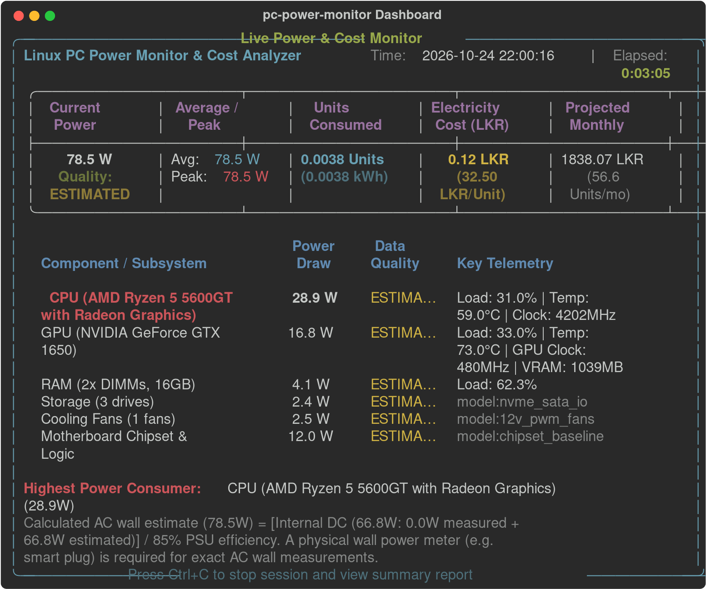

# ⚡ Linux PC Power Monitor & Cost Analyzer (`pc-power-monitor`)

[](https://www.python.org/)
[](https://www.kali.org/)
[](LICENSE)

A lightweight, terminal-based tool for **Kali Linux** and Debian-based systems that continuously monitors hardware power consumption, tracks total electricity **Units (kWh)** used, and calculates running electricity costs in **Sri Lankan Rupees (LKR)**.

---

## 📸 Preview



---

## 🚀 Quick Start (Kali / Debian)

### 1. Install Dependencies
```bash
sudo apt update
sudo apt install -y python3 python3-psutil python3-rich lm-sensors git
```

### 2. Clone & Run
```bash
git clone https://github.com/Prekarshamaxx123/pc-power-monitor.git
cd pc-power-monitor
chmod +x pc_power_monitor.py
python3 pc_power_monitor.py
```
*Press `Ctrl + C` anytime to stop the session and view the complete summary report.*

---

## 💡 Usage Examples

| Command | What it does |
| :--- | :--- |
| `python3 pc_power_monitor.py` | Start live dashboard with default rate (`32.50 LKR/Unit`). |
| `python3 pc_power_monitor.py --rate 38.50` | Use custom electricity tariff rate per Unit (LKR/kWh). |
| `python3 pc_power_monitor.py --interval 0.5` | Set refresh interval (in seconds). |
| `python3 pc_power_monitor.py --slab` | Enable CEB/LECO tiered progressive slab calculations for monthly bill estimate. |
| `python3 pc_power_monitor.py --plain` | Plain-text stream mode (ideal for SSH, background scripts, or piping). |
| `python3 pc_power_monitor.py --report` | View history of past monitoring sessions from the database. |

---

## 🔍 Monitored Hardware

- **CPU**: Utilization, frequencies, core temperatures, and RAPL / calibrated TDP power modeling.
- **GPU**: NVIDIA (`nvidia-smi`) and AMD (`hwmon`/`drm`) load, clocks, VRAM, and power limits (including unmetered slot-powered cards like GTX 1650).
- **RAM**: Memory usage and DIMM-based refresh/standby power physics.
- **Storage**: Drive I/O throughput (MB/s) and NVMe temperatures.
- **Cooling**: Motherboard fan RPMs and 12V PWM power draw.
- **Battery**: Laptop DC discharge power tracking.

---

## 📊 Output Files

Sessions are saved automatically to the `power_logs/` directory:
- **`power_session_<date>.csv`**: Per-second spreadsheet log with individual component wattage.
- **`power_monitor.db`**: Persistent SQLite database storing session history, totals, and aggregates.

---

## 🧪 Run Tests
```bash
python3 -m unittest discover -s tests -p "test_*.py"
```

## 📄 License
MIT License. 100% Free and Open Source.
